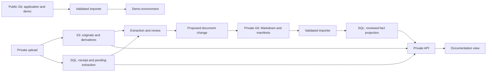

<a id="expedientes-privados-arquitectura-futura"></a>

# Private property dossiers: future architecture

Status: optional proposal. The public application retains a generalized demo
dossier and all its reusable geometry. Identifiers, precise location and original
case documents stay outside public software. This separation implements neither
S3 nor a document importer.

<a id="recomendación"></a>

## Recommendation

Separate the public application repository from the private dossier repository.
Use structured Markdown as the source of truth for reviewed knowledge, S3-compatible
storage for documents and SQL for queries and information intake workflows.

The source of truth is defined **by information type**. Reviewed data will not be
independently editable in both Markdown and SQL. The database is a queryable copy
of that knowledge, with additional operational data of its own.

| Information | Authoritative location | Role of other copies |
| --- | --- | --- |
| Code, schema, migrations, importers and technical docs | Public application Git | Images and deployments are built from a code revision. |
| Research, conclusions, reviewed dimensions, citations and property relationships | Structured Markdown in private dossier Git | SQL queries, filters and presents an imported revision. |
| Original dossier PDFs, photos, videos and binaries | Private S3 objects with stable ID and hash | Git stores manifests/references; SQL keeps the operational catalog. |
| Small API snapshots and evidence manifests | Versioned private dossier files | Indexed with citations; large snapshots may live in S3. Each source declares its original location. |
| Received uploads, pending extraction, candidates, tasks and errors | Database | Not yet reviewed facts; associated files in S3. |
| Users, permissions, sessions and operational audit | Database | Not reconstructed from Markdown. |
| OCR text, thumbnails and other derivatives | S3 for bytes; database for state/versions | Regenerable only with original, configuration and necessary tools retained. |
| Search and reviewed-fact tables | SQL projection | Reconstructible from private Git and validated manifests. |
| Fictional examples and redistributable generic assets | Public Git or public asset package | Can seed a demo without incorporating the real case. |

A public API address or cadastral record does not make our dossier, its interior
relationships or the owner's identity public. The open application's example
will be generalized. The installation accessing the real apartment will be private.

<a id="repositorios-y-archivos"></a>

## Repositories and files

Proposed structure, not yet created. Spanish path names below are proposed
identifiers retained from the original design:

```text
t3-designer/                         # Public software repository
  apps/web/                         # Three views without embedded real data
  apps/api/                         # Reading and future authorized ingestion
  packages/dossier-schema/           # Contract and pure validators
  packages/dossier-import/           # Markdown reader and reconciliation
  migrations/                       # Database schema
  docs/                             # Architecture, method and technical docs
  examples/demo/                    # Fictional/licensed Markdown and assets

t3-dossier/                         # Private Git outside the public checkout
  inmueble.md                       # Index and references by ID
  entidades/*.md                    # Parcel, building, lot, apartment, room
  hechos/*.md                       # Reviewed assertions and evidence
  investigaciones/*.md              # Narrative and open questions
  fuentes/*.md                      # Issuer, version, access, citations, location
  snapshots/                        # Small snapshots with provenance
  manifests/                        # Object index and content revisions
```

Repository names are proposals. The public example can become a content template
without publishing the original dossier.

A private repository checkout provides `.md` files on the filesystem. At runtime
it can be mounted read-only for the importer, without copying it into the public
image. The read backend does not need Git writes to display information. Content
revisions are independent of software revisions.

<a id="markdown-como-fuente-de-verdad-útil"></a>

## Markdown as a useful source of truth

Application fields will use validated YAML frontmatter. The Markdown body
explains interpretations, differences and decisions. Free-form tables will not
be heuristically mined for SQL values.

Abbreviated **fictional** format example:

```markdown
---
schemaVersion: 1
id: demo-area
entityId: demo-apartment
visibility: public
assertions:
  - id: demo-area-claim
    property: area.carrez
    value: 42
    unit: m2
    evidenceType: synthetic
    reviewStatus: example
    sourceId: demo-document
    locator:
      printedPage: "3"
---
# Example area

Invented data for application testing. It describes no real property.
```

Every real assertion needs scope, definition, unit, evidence type, review status,
source and locator. Sources add issuer, dates, version, privacy and an original
file/object reference. Distinguish PDF page position from printed numbering;
preserve fields/JSON Pointers for APIs and ID/time for videos. Entity relationships
also require evidence.

Web tables are generated from these fields. Markdown tables repeating values
will be generated or checked for consistency; there will be no independently
editable JSON catalog with the same quantities. Generated JSON may be a revision
artifact without becoming another editable source.

Retain alternatives and discrepancies: an area with another definition, date or
scope does not automatically replace an assertion. Numeric precision does not
improve source accuracy. Unknowns remain unknown; the 3D model stays identified
as an estimated representation.

<a id="flujo-de-datos-y-autoridad"></a>

## Data flow and authority



Correcting an established fact changes its Markdown, followed by reimport. A
future editing UI will propose a change against the known Git revision rather
than writing the same value directly to SQL. The first version can use command
imports and file editing, avoiding automatic Git writes before they are needed.

A new upload creates a private operational record and object. Extraction produces
candidates, not confirmed facts. Review incorporates them into Markdown with
citations. Preserve links between receipt, candidate and incorporated assertion;
do not lose evidence or confuse pending with current state.

<a id="sembrar-db-y-storage-desde-archivos"></a>

## Seed database and storage from files

Seeding works for catalogs and assets **actually present in that source**.
Separate entrypoints cover:

- Demo: public repository, generalized data and redistributable resources.
- Real dossier: private repository and incorporated private originals.
- Application uploads: database/S3, outside seed scope.

Importer contract:

1. Validate schema, references, scope and access; show a change plan before applying.
   Distinguish schema version, Git revision and imported revision.
2. Identify records by `originNamespace` and stable ID; retain hash, origin
   revision and managing importer. Do not match by name.
3. Reimporting the same revision produces the same state. Changes update only
   records managed by that origin, never operational uploads.
4. Publish the SQL projection transactionally after validating the whole set.
   An invalid revision leaves the previous one active and identifies the error.
5. Missing records may be marked withdrawn within their origin. Do not
   automatically delete objects, history or uploads absent from a manifest.
6. New objects receive stable references and content hashes. Never silently
   replace bytes of a document already referenced by citations.

SQL and S3 share no transaction. Ingestion uses explicit states (`pending`,
`stored`, `indexed`, `failed`) and retryable operations: verify object/hash before
marking availability, tolerate interruptions between systems and reconcile orphan
objects with review rather than automatic deletion.

Do not reset data at startup or deployment. Initial seeds and controlled updates
are separate from application startup. Illustrative commands `dossier:validate`,
`dossier:plan`, `dossier:import` and `demo:seed` do not exist yet.

<a id="qué-se-puede-reconstruir-y-qué-necesita-conservarse"></a>

## What is reconstructible and what must be retained

| Lost item | Recoverable from Git? |
| --- | --- |
| Code and versioned demo | Yes, from their revision and dependencies. |
| Reviewed-fact SQL projection | Yes, from document repository and manifests; cited objects must remain available. |
| Original uploaded only to S3 | No. A hash manifest does not contain bytes. |
| Pending upload/OCR, users, permissions or audit | Not necessarily; retain database and corresponding objects. |
| Application container | Must be replaceable while retaining persistent content. |

Recovery must cover **private Git, database and objects**, not only reseeding.
Object versioning can recover overwrites; S3 disables it by default and requires
explicit configuration. Validate support when choosing a compatible provider.
[Official S3 Versioning documentation](https://docs.aws.amazon.com/AmazonS3/latest/userguide/Versioning.html).

<a id="containers-y-elección-de-servicios"></a>

## Containers and service selection

Minimal proposal: an API, PostgreSQL database, S3 provider and importer running
as a command/job. PostgreSQL is a design recommendation, not a created instance
or existing infrastructure requirement. Additional microservices, CMS, vector
search and a separate queue are unnecessary for now.

PostgreSQL and object servers can run in containers. Their data must persist
outside the disposable layer, using volumes/disks or external services. Docker
volumes survive container deletion; files in the writable layer do not.
Persistence does not necessarily mean another server.
[Docker storage](https://docs.docker.com/engine/storage/).

Define an S3 adapter by contract, without product-exclusive features. **Do not
automatically choose MinIO Community:** its [official repository](https://github.com/minio/minio),
consulted on 27/09/2026, appeared archived on 25/04/2026 and stated it was no longer
maintained. Choose a provider after assessing deployment, maintenance and required
features. This does not change the proposal's division of responsibilities.

<a id="acceso-privado-y-publicación-del-software"></a>

## Private access and software publication

The API verifies dossier access before returning metadata/documents. Real buckets
are private. Originals are served through the API or short-lived signed URLs
after authorization; signed URLs are not durable references. Manifests use IDs,
object keys/versions and hashes, never credentials or personal disk paths.

One software UI can serve a public generalized demo and a private real dossier.
Changing the dataset does not authorize public access. Derivatives, extractions
and thumbnails inherit original access. Private content never enters static
frontend, public fixtures, container images, public CI logs or open-repository docs.

<a id="frontera-actual-del-ejemplo-público"></a>

## Current public-example boundary

Demo geometry remains reusable, with local IDs, an approximate regional solar
origin and illustrative data. Real-case originals, operational evidence and
location records are outside the public repository. Distinctive geometry does
not guarantee anonymity against shape comparison. A future real dossier needs
authorization and access control.

New originals and derivatives must not automatically enter public sources,
fixtures, snapshots, binaries, captures or builds. Cleaning the current tree
does not erase Git history: review history separately and do not rewrite it
without an explicit coordinated decision.

<a id="fases-de-implementación"></a>

## Implementation phases

1. **Contract and classification:** consolidate responsibilities, Markdown format
   and manifests; inventory private dossier content. Keep reconstruction working
   while preparing the generalized example.
2. **Separate application and content:** private repository/dataset, API loading,
   Blender export from an explicit revision and generalized public demo. Choose
   provider/persistence when a concrete deployment destination exists.
3. **First document view:** private Markdown → importer → SQL projection → API →
   third tab. Read S3 documents and update without rebuilding React. Retain 3D view
   state, lazy loading and reading without WebGL.
4. **Purchase documents:** private uploads, per-page extraction, review, candidates
   and promotion to Markdown; expose conflicts and version changes.
5. **Operation and publication:** verify separation, authorization, integrity and
   recovery. Publish only software/demo; the dossier stays private.

Meaningful implementation tests: idempotent reimport, new revision visible without
rebuild, uploads unchanged by reconciliation, recovery after SQL/S3 interruption,
valid references/versions, rejection of concurrent updates based on stale
revisions, projection reconstruction and denial of others' documents. Verify
public repository, history and build contain no private-case data.

This proposal implements no services, new repositories, importers or migrations.
The third view develops separately within the [local POC](../research/property-dossier.md),
without depending on these future components.
