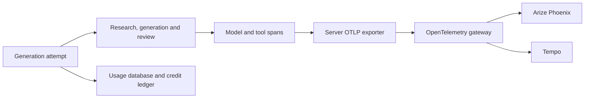

# Generation tracing and usage

T3 can export backend generation traces using OTLP/HTTP to an OpenTelemetry
gateway. A gateway configured for Phoenix and Tempo sends the same trace to the
agent inspection UI and the general tracing backend. This integration adds
application instrumentation; collector configuration and deployment remain an
installation concern.

The account's **Settings → Usage** view remains the place to inspect durable
credit and token records. Phoenix provides the execution timeline and the
relationship between an attempt, its stages and its model calls.



## Enable in native development

Follow the [local backend guide](local-backend.md) first. Add the following to
your private local `.env`, replacing the example domain with your installation's
existing gateway:

```dotenv
OTEL_EXPORTER_OTLP_ENDPOINT=https://otel.example.com
OTEL_SERVICE_NAME=t3-designer-api
OTEL_SERVICE_VERSION=local
T3_TELEMETRY_ENVIRONMENT=dev
```

Start or restart `pnpm dev:full` after changing the environment. Configuration
belongs to the server; no `VITE_` telemetry variable or browser exporter is
required. The public static demo does not emit these traces.

`OTEL_EXPORTER_OTLP_ENDPOINT` is the gateway base URL. The exporter appends
`/v1/traces`. To provide the complete traces URL instead, set
`OTEL_EXPORTER_OTLP_TRACES_ENDPOINT`; it takes precedence and is used exactly as
supplied. Use the gateway's OTLP/HTTP route, not the Phoenix UI URL or the OTLP
gRPC port. Remote collectors require HTTPS; plain HTTP is accepted only for
`localhost`, `127.0.0.1` or `[::1]` test receivers. Endpoint URLs must not contain
credentials, query strings or fragments.

If the gateway requires authentication, configure
`OTEL_EXPORTER_OTLP_TRACES_HEADERS` privately on the server, or
`OTEL_EXPORTER_OTLP_HEADERS` as the fallback. The traces-specific value takes
precedence. Both accept comma-separated `name=value` pairs with percent-encoded
values, for example `Authorization=Bearer%20YOUR_TOKEN`. These headers are sent
only to the configured collector; never put them in frontend configuration or
commit real values. The Phoenix project is identified by the resource attribute
`openinference.project.name`, using `<service.name>.<deployment.environment>`.

The service defaults to `t3-designer-api`, its version to `0.0.0`, and the
environment to `prod` when `NODE_ENV=production` or `dev` otherwise. Set
`OTEL_SERVICE_VERSION` to the build's Git commit when that is available. The
resource records both `deployment.environment` and
`deployment.environment.name`. Optional `cluster`, `k8s.namespace.name` and
`k8s.pod.name` values can be supplied through `OTEL_RESOURCE_ATTRIBUTES`; other
arbitrary resource attributes are not forwarded.

Without an endpoint, tracing is disabled; `OTEL_SDK_DISABLED=true` also disables
it explicitly. Invalid configuration disables tracing with a generic warning
and leaves generation available. No private collector hostname or credential is
stored in the public repository. Operator endpoints and access details belong
in the private installation configuration described in the
[public/private boundary](public-private-boundary.md).

## Read an attempt in Phoenix

With the example settings above, select `t3-designer-api.dev` in Phoenix, then
open a generation attempt. Use the T3 operation identifier to correlate it with
the durable usage record. An attempt covers the generation workflow and its internal stages;
individual model calls carry their stage and iteration so review and correction
rounds can be distinguished.

Spans use OpenInference kinds: `AGENT` for an attempt, `CHAIN` for workflow
stages, `LLM` for model calls, `RETRIEVER` for reference loading and `TOOL` for
deterministic work such as rendering and validation. This makes the agent's
structure inspectable without exposing its prompt or reasoning text.

The metadata describes:

- The generation kind, operation identifier and outcome.
- The stage, iteration, elapsed time and success or failure of each call.
- The provider, authentication mode, requested model and effective model when
  reported by the provider.
- Input, output, cached input and reasoning tokens when available.
- The credit reservation and its final consumed or refunded state.

Keep token measurements and credits distinct. Credits are T3's product units,
recorded in its credit ledger. Tokens are provider measurements for individual
calls. A failed or cancelled task can consume tokens even when T3 refunds the
credit reservation. Unknown usage remains unknown; it is not recorded as zero.

Local Codex uses the signed-in ChatGPT subscription and is labeled separately
from hosted OpenAI API inference. Token measurements from a local session do not
represent charges against an OpenAI API key. T3 does not export a calculated
dollar cost. Any dollar estimates Phoenix derives from model pricing are
estimates, not T3 credits or an invoice; cached tokens, pricing changes and
provider billing rules can affect those estimates.

## Privacy and failure behavior

Exported data is restricted to operational metadata and numeric usage. It does
not include prompts, generated answer text, uploaded images or documents,
addresses, source URLs, raw tool arguments/results, credentials or raw error
messages. Opaque internal identifiers correlate records without exporting user
names, email addresses or project labels. Traces still belong to the private
installation and follow its access and retention policy.

The server buffers completed spans in a bounded in-memory queue. Export is
best-effort: unavailable ingestion, a full queue or process termination can
leave gaps in Phoenix. Export failure must not turn a successful generation
into an application failure. The usage database and credit ledger retain their
own persistence and do not depend on the exporter.

Tracing starts with new work after it is enabled. It does not reconstruct old
traces from historical usage records or provide a persistent delivery queue.
Restarted or interrupted work may therefore have an incomplete trace even when
its usage state can be recovered from the database.

## Validate without a paid inference

Run the API tests to exercise tracing and usage with synthetic fixtures:

```sh
pnpm --filter @t3-designer/api test
pnpm --filter @t3-designer/api typecheck
pnpm --filter @t3-designer/api lint
```

These checks do not require a real OpenAI request. A passing exporter test proves
the application payload and delivery behavior against the test receiver; it
does not prove that an installation's gateway or Phoenix has received a trace.

To check delivery to an existing collector without generating content, configure
the endpoint and run:

```sh
pnpm --filter @t3-designer/api telemetry:smoke
```

This sends a synthetic trace and prints its operation and trace identifiers. It
requires an explicit endpoint, makes no model requests and leaves the usage
database and credit ledger untouched. Its metadata is marked synthetic so it
can be distinguished from real generation activity. Open Phoenix separately
and find the printed trace identifier to verify downstream ingestion; successful
submission to a collector alone does not establish Phoenix reception.

For a manual end-to-end check, enable the endpoint, run one intentional
generation, then inspect that attempt in both **Settings → Usage** and Phoenix.
Match the operation, provider, model and observed tokens; confirm the child
stages and final credit outcome. Also inspect the trace attributes to confirm
that only the expected metadata is present. A real hosted generation can consume
API tokens. Verify actual ingestion separately before calling the integration
live, and record deployment evidence in the private installation repository.
