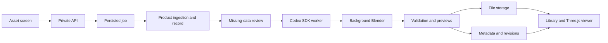

<a id="generación-de-assets-3d-en-servidor"></a>

# Server-side 3D asset generation

Research from October 3, 2026 for T3 Designer's next iteration. The technical
claims below describe that research date and have not been reverified by the
language audit.

**Furniture can be created on a server and then used in the interactive
apartment.** The proposal runs Codex in a private worker directing Blender through
Python, generates a GLB and retains an editable version and references. The
project already has a headless Blender pipeline. Fidelity from product photographs
is the main uncertainty, rather than remote Blender execution.

This document preserves research and proposed architecture. **Update from the
same iteration:** the [local workshop](../workflows/local-asset-workshop.md) was
implemented with a library screen, API, SQLite queue, Codex SDK using the existing
ChatGPT subscription and background Blender. Remote infrastructure and faithful
automatic photographic reconstruction remain pending. Agent web search can read
product pages and request missing data; it is not yet complete visual ingestion
from any store.

<a id="primer-producto-elegido"></a>

## First selected product

The user selected [IKEA STRANDMON Nordvalla gris oscuro, 203.432.24](https://www.ikea.com/es/es/p/strandmon-sillon-orejero-nordvalla-gris-oscuro-20343224/)
for correct dimensions and visual resemblance. The Spanish external variant name
is retained. Exterior width 82 cm, depth 96 cm and height 101 cm agree between
text and drawing. Web width × height × depth is `[0.82, 1.01, 0.96]` m. These are
manufacturer dimensions, not our measurements or packaging sizes.

**Seat discrepancy:** text states width 49 cm and height 45 cm;
[the drawing on the same page](https://www.ikea.com/es/es/images/products/strandmon-sillon-orejero-nordvalla-gris-oscuro__0963366_pe808498_s5.jpg?f=u)
says 50 and 43 cm. Both give depth 54 cm. The draft provisionally follows the
text and retains both sources; these dimensions must not be marked unambiguous.

Gallery and public 3D viewer show rolled arms, wings, back buttons, a separate
cushion and dark legs. References identified:
[front perspective](https://www.ikea.com/es/es/images/products/strandmon-sillon-orejero-nordvalla-gris-oscuro__0325432_pe517964_s5.jpg?f=xl),
[rear](https://www.ikea.com/es/es/images/products/strandmon-sillon-orejero-nordvalla-gris-oscuro__0836847_pe596292_s5.jpg?f=xl)
and [arm detail](https://www.ikea.com/es/es/images/products/strandmon-sillon-orejero-nordvalla-gris-oscuro__1494736_pe1004875_s5.jpg?f=u).
The viewer displayed the product, but no reusable official 3D file was obtained.

Mark curves, angles, leg lengths, seams and material response as inferred.
Resemblance approval remains pending multi-view comparison. Retaining SKU and
variant prevents mixing upholstery/version references.

<a id="blender-y-codex-en-el-servidor"></a>

## Blender and Codex on the server

| Question | Result |
| --- | --- |
| Do we need the Mac or a Blender window? | No. Blender supports background scripts, modeling, export and rendering. It must be installed on the server; this pipeline needs no graphical session. |
| Can we use only a Python API? | Yes: `bpy` is Blender's Python API and an installable module. The recommendation here is Blender's executable with bundled Python, reusing scripts and isolating each job in a process. |
| Do we need a GPU? | Procedural modeling/export and Cycles CPU thumbnails can start on CPU. GPU is a later optimization or a dependency of a self-hosted neural generator. |
| Does the current MCP work headlessly? | Installed `mcp-for-blender 2.1.0`, protocol 11, explicitly rejects `bpy.app.background`. It depends on UI timers and viewport captures. |
| Can that MCP run on Linux? | Its code proposes a graphical UI with a virtual display such as Xvfb: a different architecture with more dependencies. Its Docker alone does not install an operational headless Blender. |

Primary sources: [Blender CLI](https://docs.blender.org/manual/en/4.5/advanced/command_line/index.html),
[bpy module](https://docs.blender.org/api/main/info_advanced_blender_as_bpy.html),
[threading limits](https://docs.blender.org/api/5.0/info_gotchas_threading.html)
and [MCP add-on code](https://raw.githubusercontent.com/ahujasid/mcp-for-blender/main/src/blender_mcp/bundled/addon.py).
UI dependency was also checked in the locally installed package, not inferred
solely from its README.

MCP is optional: Codex can invoke a generation command directly. A later small
MCP could expose generation, validation and rendering delegated to the worker.
Review images come from rendered cameras rather than window captures.

The official documentation consulted described these OpenAI interfaces:

| Interface | Capabilities | Proposed fit |
| --- | --- | --- |
| Codex SDK | Programmatic application/background-job integration; server-side TypeScript library with session continuation. | First choice for an asset creation job. |
| Codex app server | Client protocol for history, authentication, approvals and events. Documentation marks WebSocket transport experimental and unsupported for production. | Assess for deeper agent interaction; keep behind the backend. |
| Agents API with a self-hosted environment | OpenAI operates the harness; our container runs commands/MCP through `codex exec-server`. | Managed alternative requiring account-access validation; differs from hosting the entire harness. |

Sources: [Codex SDK](https://learn.chatgpt.com/docs/codex-sdk),
[app server](https://learn.chatgpt.com/docs/app-server),
[Agents API](https://developers.openai.com/api/docs/guides/agents-api/overview)
and [self-hosted environments](https://developers.openai.com/api/docs/guides/agents-api/environments/self-hosted).
Do not base this on old `codex mcp-server` examples: SDK documentation consulted
says the command was removed. Agents SDK is another option for our own agent
loop; adding it above Codex SDK is unnecessary for this case.

Hosting Codex with SDK means hosting the organizing process/tools; inference
still uses the model service. For the local iteration the user explicitly chose
the CLI ChatGPT session: the adapter needs no API key and calls use subscription
limits. Integration was checked with real STRANDMON analysis. Remote-service
identity and billing remain undecided. [Official authentication](https://learn.chatgpt.com/docs/auth).

<a id="de-una-url-a-un-mueble"></a>

## From a URL to furniture

Proposed flow:

1. **Collect evidence.** Fetch the public page; extract product data, images,
   dimensions and selected variant. Try HTML/structured data first, then automated
   browsing for JavaScript pages. SDK does not automatically turn a URL into a
   complete product record. Schema.org supports dimensions, materials, images and
   variants, but stores may omit them. [Product contract](https://schema.org/Product).
2. **Prepare a reviewable record.** Show dimensions in meters, matching-variant
   photos, finish and sources. Separate product/packaging dimensions; classify
   store-declared, user-confirmed and estimated data. Ask for missing essential
   dimensions before publishing an asset usable for fit checks.
3. **Choose a method.** Reuse an authorized manufacturer model if available;
   generate parametric geometry for regular furniture; evaluate image-to-3D for
   upholstery and complex shapes.
4. **Generate and review.** Render front, side and perspective views; compare
   references and correct within bounded attempts. Record parts inferred because
   photos do not show them.
5. **Validate and save a revision.** Export GLB; check actual dimensions, materials
   and resources; generate thumbnails and retain `.blend`, record, references,
   generator version and hashes. Visual approval publishes the library revision.

One photograph cannot uniquely determine rear shape, depth, seams or internal
structure. Correct dimensions and enough resemblance for decorating are a
reasonable first goal. A faithful commercial replica needs real-product trials
and more evidence; do not invent dimensions that appear measured.

Complementary candidates: [Meshy](https://docs.meshy.ai/en/api/multi-image-to-3d)
documents 1–4 images of one object, PBR materials and GLB output;
[Tripo](https://platform.tripo3d.ai/docs/generation) documents multi-view generation
with explicit camera positions; [Hunyuan3D](https://github.com/Tencent-Hunyuan/Hunyuan3D-2)
publishes inference and an API server for self-hosted neural generation. No
selection is validated: results, per-asset prices and latency were not compared.
All still need Blender normalization and dimensional control.

<a id="arquitectura-propuesta"></a>

## Proposed architecture



Backend and worker can start on one server as separate processes. Heavy work
must survive browser closure and not depend on HTTP request timeout. Start with
persistent database and one worker; job reservations/retries avoid requiring
Redis immediately. Blender processes have their own workspace, runtime limit and
bounded concurrency. Production queue/isolation are not yet in the repository.

Proposed states: `queued`, `extracting`, `needs_input`, `generating`, `validating`,
`draft`, `ready`, `failed`, `cancelled`. The application saves job/agent-session
IDs, shows events and resumes after missing information is supplied. Idempotency
prevents duplicate jobs; attempts have separate outputs. Only validated, approved
revisions are presented as ready.

Use S3-compatible object storage for models/previews/references and PostgreSQL
for catalog/jobs/revisions. S3/R2 support temporary signed object URLs; the browser
gets no bucket credentials. Provider remains open. Store stable object keys,
not expiring signed URLs. [S3](https://docs.aws.amazon.com/AmazonS3/latest/userguide/using-presigned-url.html),
[R2](https://developers.cloudflare.com/r2/api/s3/presigned-urls/).

Each revision should retain `assetId`, `revisionId`, category, dimensions and
provenance, orientation, support surface, material slots, file keys, hashes,
generator and review status. Apartment instances point to concrete revisions;
model improvements do not silently change decorated rooms.

Ingestion must restrict public destinations and validate redirects to prevent
internal-address access from submitted URLs. Store text is evidence, not agent
instructions. Generated code runs in a resource-limited container without
production secrets, host access or Docker socket. Backend controls publication
and permissions; agent responses alone grant neither. These are future service
requirements, not capabilities added by the current prototype.

<a id="encaje-con-t3-designer"></a>

## Fit with T3 Designer

The existing foundation has React, Three.js, GLB loading, metric geometry and
reproducible Blender export. Web conventions are meters, Y-up, front +Z; Blender
uses `(x, -z, y)`. [Current architecture](../architecture/architecture.md) and
[Blender workflow](../workflows/blender.md).

Contract changes remain: `AssetSchema` only accepts `/models/` and estimated
dimensions; snapshots require repository files; `Fixtures` reads static catalog
and instances. A remote library needs a versioned asset contract, file resolver
and persisted decorating state. Retain the current reconstruction catalog and
add a user-design layer with explicit IDs/revisions.

The future screen has URL/notes input, editable sourced dimensions, pending
questions, progress, rotating preview and revisions. Library publication is
separate from draft generation. This functional proposal adds no simulated UI.

For the original request «poné la televisión encima del mueble» (put the TV on
the cabinet), the agent emits a structured operation such as
`place_on(tvInstanceId, standInstanceId, surfaceId)`. The engine resolves the
surface, supports the object's base, checks fit/collisions and saves an undoable
operation. The relationship lets both objects move together; translation needs
no geometry regeneration. Changing a tablecloth's color may change material;
changing its drape/folds needs new geometry or simulation.

<a id="primer-incremento-y-criterios-de-avance"></a>

## First increment and advancement criteria

The initial trial implements JSON records and a background Blender command with
independent outputs. It includes a synthetic table and a STRANDMON draft made
from references during this research. It checks the generation contract and
prepares a worker; reference selection and chair-recipe writing in this session
are not yet an autonomous URL → Codex SDK → model flow.

```sh
pnpm blender:generate --input scripts/blender/fixtures/table-job.json --output-dir artifacts/generated-assets/my-table-v1
```

Every run needs a new directory and produces `model.glb`, `source.blend`,
`preview.png`, `request.json` and `manifest.json`. Verified run:
`artifacts/generated-assets/table-proof-v2/`, GLB 71,484 bytes, 940 triangles,
5 meshes, one material, no cameras/lights/external dependencies. Export dimensions
1.20 × 0.75 × 0.70 m within numeric tolerance. Three.js `GLTFLoader` also loaded
it and its bounds/support at Y=0 were checked. Manifest records tabletop support
at 0.75 m.

Generation with a 384 × 384 / 16-sample Cycles CPU preview took about 1.28 s on
this Mac, not a server or reconstructed-chair benchmark. `pnpm check` passed;
final Python suite has 28 tests. Local sandbox Blender failed during Metal
initialization before Python; an isolated process outside it completed the trial.
The open graphical session was unchanged.

Reproduce the chair draft with:

```sh
pnpm blender:generate --input scripts/blender/fixtures/strandmon-job.json --output-dir artifacts/generated-assets/my-strandmon-v1 --resolution 640 --samples 32
```

Its recipe also produces front/side views. Upholstery shapes and fabric are trial
approximations. A valid GLB with correct volume is not a faithful replica; visual
evaluation remains open. Dimensions, source conflict, inferences and draft state
stay in the manifest.

Final sample: `artifacts/generated-assets/strandmon-draft-v4/`. GLB 961,664 bytes,
46,448 triangles, 20 meshes, 3 materials and one embedded texture; no external
resources or studio objects. Measured envelope 0.82 × 1.01 × 0.96 m, floor origin.
Chrome/Three.js `GLTFLoader`: complete load, 256 × 256 texture present, no loader
errors. Renders and `browser-perspective.jpg` were inspected.

Those files and three 640 × 640 / 32-sample renders took about 5.94 s on this Mac.
This times an already written recipe, excluding product research, recipe creation
and visual iteration. Cushion inferred outer width is about 62.3 cm, separate
from published usable seat width. Its top is at 45 cm per the provisional text
choice, avoiding presentation of visual interpretation as manufacturer measurement.

For real-asset acceptance, check dimensions within agreed tolerance, floor origin,
orientation, self-contained loadable GLB, complexity limit, multi-view previews
and visual comparison with photos. Record ingestion, agent, modeling, render and
web-load time separately, with model usage and provider costs. Sample rendering
time does not predict chair-reconstruction cost.

Next increments: run the same trial on Linux; make manual STRANDMON extraction
reproducible with a reviewable record; evaluate Codex-assisted generation and,
if needed, image-to-3D; add persistent storage/jobs; integrate library, then
decorating operations. The table checks mechanics; the chosen chair evaluates
soft-shape resemblance.

No remote infrastructure was deployed or services purchased. The local binary is
Blender 5.2.2 LTS. Docker is installed, but its daemon was unavailable during the
research; a macOS execution must not be presented as Linux validation.
